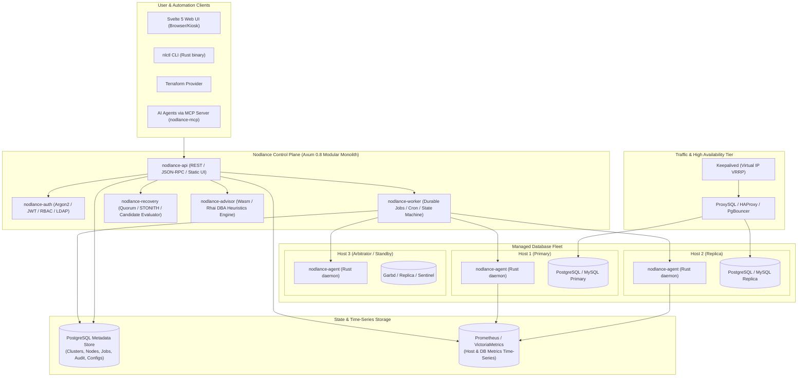

# Nodlance: Severalnines ClusterControl Parity & Evolution Plan

**Document Version:** 1.0.0  
**Target Architecture:** Rust Control Plane (`crates/nodlance-*`), PostgreSQL Metadata Store, Svelte 5 Web UI, Rust Node Agent (`nodlance-agent`), `nlctl` CLI, and Model Context Protocol (MCP) Server.  
**Reference Sources:**
- Severalnines ClusterControl Reference Manual (Release 2.5.0 / Aug 2026) — `docs/clustercontrol-2.5.0.pdf`
- Severalnines ClusterControl Online Documentation (`https://docs.severalnines.com/clustercontrol/latest/`)
- Nodlance Foundation Architecture (`docs/ARCHITECTURE.md`, `docs/PRD.md`, `docs/ROADMAP.md`)

---

## 1. Executive Summary & Vision

Severalnines **ClusterControl** is the industry standard for on-premises and hybrid cloud database operations, providing automated deployment, high availability, backup management, load balancing, performance monitoring, and security across open-source and proprietary database engines.

**Nodlance** is architected as a next-generation, open-source alternative built on modern systems foundations:
1. **Memory-Safe & High Performance:** Built in **Rust** rather than legacy C++/PHP/Java, offering sub-millisecond API responses, minimal memory footprints (< 25MB for the controller, < 15MB for the node agent), and zero garbage collection pauses.
2. **First-Class Modern Web UI:** Built with **Svelte 5** and native CSS design tokens (`ui-ux-pro-max`), offering instant reactivity, real-time animated topology streams, and kiosk/NOC wallboard mode without bloated SPA frameworks.
3. **Safety-First Failover Gates:** Strict STONITH node fencing, cryptographic operator approval tokens (two-man rule), quorum verification, and epoch tracking to prevent split-brain and rogue primary write corruption.
4. **Cloud-Native & GitOps Ready:** Native Kubernetes Operator discovery, Docker daemon integration, HashiCorp Vault credential integration, and Terraform provider.
5. **AI-Native Operations:** Native **Model Context Protocol (MCP)** server enabling AI coding and DBA agents (Claude, Gemini, local models) to inspect topology, diagnose slow queries, verify backup drills, and draft migration plans safely.

---

## 2. Severalnines ClusterControl Feature Inventory & Gap Analysis

Based on the 1,450-page ClusterControl 2.5.0 Reference Manual (`clustercontrol-2.5.0.pdf`) and Severalnines documentation, here is the complete breakdown of capabilities and their corresponding Nodlance implementation status:

### 2.1 Database Engines & Topologies

| Engine & Topology | Severalnines ClusterControl Support | Nodlance Current State | Target Nodlance Milestone |
|---|---|---|---|
| **PostgreSQL Streaming Replication** (Sync/Async) | Full lifecycle, failover, switchover, PITR | ✅ Stage 2 & 5 implemented | Phase 1 (Enhance sync/async auto-tuning) |
| **PostgreSQL Logical Replication** | Pub/Sub management, table filtering | 🟡 Domain stub exists | Phase 1 (Pub/sub orchestrator) |
| **TimescaleDB** | Time-series hypertable monitoring, multinode | 🟡 Compatible via Postgres adapter | Phase 1 (Hypertable metrics adapter) |
| **MySQL / Percona / MariaDB Replication** (GTID) | Master-slave, semi-sync, multi-source, failover | ✅ Stage 2 & 5 implemented | Phase 1 (Multi-source replication) |
| **MySQL Galera / Percona XtraDB / MariaDB Galera** | Multi-primary, SST/IST, Garbd arbitrator, desync | 🟡 Domain stub exists | Phase 1 (SST state machine, Garbd) |
| **MySQL Group Replication (InnoDB Cluster)** | Single/Multi-primary, Paxos quorum, member states | 🟡 Domain stub exists | Phase 2 (Group membership reconciliation) |
| **Redis & Valkey Sentinel** | Sentinel quorum, auto-failover, replica priority | ⚪ Not started | Phase 3 (Redis/Valkey adapter crate) |
| **Redis & Valkey Cluster** | Hash slots, resharding, multi-master cluster | ⚪ Not started | Phase 3 (Slot distribution engine) |
| **MongoDB / Percona Server for MongoDB** | Replica Sets, Sharded Clusters, arbiters | ⚪ Not started | Phase 4 (MongoDB wire protocol adapter) |
| **Microsoft SQL Server (Linux)** | Standalone, Always On Availability Groups | ⚪ Not started | Phase 5 (mssql Linux adapter) |
| **ClickHouse & Elasticsearch** | Analytical and search cluster observability | ⚪ Not started | Phase 6 (Read-only observability adapter) |

### 2.2 Load Balancing & Connection Routing

| Component | ClusterControl Implementation | Nodlance Target Architecture | Target Milestone |
|---|---|---|---|
| **ProxySQL** | Read/write splitting, query rules, hostgroups, fast failover, connection pooling | `nodlance-proxy-proxysql` module with admin interface (port 6032) automation | Phase 2 |
| **HAProxy** | Layer 4/7 TCP proxy with `mysqlchk`/`pgchk` health scripts | Managed HAProxy configuration templates with dynamic reload | Phase 2 |
| **Keepalived** | Virtual IP (VIP) failover over VRRP for HAProxy/ProxySQL pairs | Keepalived daemon automation with track-script validation | Phase 2 |
| **PgBouncer** | Connection pooling (session, transaction, statement), user auth pass-through | Embedded PgBouncer configuration and pool sizing manager | Phase 1 |
| **MariaDB MaxScale** | Read-write splitter router, binlog router, schema router | MaxScale REST API client integration | Phase 4 |
| **Garbd (Galera Arbitrator)** | Non-storage lightweight quorum node in odd-numbered Galera clusters | Integrated lightweight Garbd daemon launcher | Phase 1 |

### 2.3 Backup, Disaster Recovery & Verification Drills

| Feature | ClusterControl Implementation | Nodlance Target Architecture | Target Milestone |
|---|---|---|---|
| **Physical Backups** | Percona XtraBackup, Mariabackup, pg_basebackup, pgBackRest | Native adapter implementations with progress streaming | Phase 1 & 3 |
| **Logical Backups** | mysqldump, mariadb-dump, pg_dump, mydumper | Multi-threaded logical dump runner with compression | Phase 1 |
| **Point-in-Time Recovery (PITR)** | Continuous WAL/binlog archiving, restore to timestamp or LSN | Archiver daemon, WAL/binlog catalogue, target time restore | Phase 3 |
| **Automated Restore Verification** | Spinning temporary VM/container, restoring, running integrity check | Ephemeral Docker/VM qualification drill runner with SHA-256 validation | Phase 3 (Completed in UI, backend drill worker next) |
| **Cloud Storage Offloading** | AWS S3, Google Cloud Storage, Azure Blob, MinIO | Integrated S3-compatible chunked uploader with multipart/resumable | Phase 3 |
| **Backup Encryption & Compression** | AES-256 GCM, Pigz, Zstd, gzip | In-flight Zstandard compression and AES-256-GCM envelope encryption | Phase 3 |
| **Retention & GFS Policies** | Grandfather-Father-Son scheduling, automatic pruning | Durable cron scheduler in `nodlance-worker` with retention rules | Phase 1 |
| **Create Cluster from Backup** | 1-click cloning of production cluster from snapshot | Automated provisioning pipeline seeded with backup payload | Phase 4 |

### 2.4 High Availability, Failover & Node Fencing

| Feature | ClusterControl Implementation | Nodlance Target Architecture | Target Milestone |
|---|---|---|---|
| **Candidate Evaluator** | Elects replica with lowest lag, highest GTID/LSN, hardware suitability | `nodlance-recovery::evaluator` ranking matrix | Phase 1 (Refine algorithm) |
| **Quorum Verification** | Majority consensus before failover initiation | Strict $N/2 + 1$ quorum check with Raft lease awareness | Phase 1 |
| **STONITH / Node Fencing** | IPMI, SSH power-off, route blackholing | Multi-driver fencing (SSH poweroff, AWS/GCP API, network drop) | Phase 1 |
| **Operator Approval Token** | Two-man approval rule for destructive/promotion actions | Cryptographic Ed25519 approval token with TTL and audit binding | Phase 1 (Completed in UI & recovery crate) |
| **Controller High Availability** | CMON Controller Pool, Active/Passive Standby Controller | Raft-based `nodlance-controller-pool` or PostgreSQL advisory lease HA | Phase 4 |
| **Auto-Recovery State Machine** | Configurable retries, progressive recovery, alert escalation | Bounded attempt state machine in `nodlance-worker` | Phase 2 |

### 2.5 Observability, Query Monitoring & Performance Advisors

| Feature | ClusterControl Implementation | Nodlance Target Architecture | Target Milestone |
|---|---|---|---|
| **Real-Time Dashboards** | Cluster overview, QPS, latency, connection counters | Svelte 5 dashboard with WebSocket metric push | Phase 1 |
| **Topology Map** | Interactive topology visualization with lag and role states | Interactive SVG topology graph with animated replication links | Completed in UI; enhance with live WebSocket |
| **Slow Query Analyzer** | Reads slow query logs or Performance Schema, aggregates digests | Performance Schema / `pg_stat_statements` collector | Phase 2 |
| **Deadlock Detection** | InnoDB lock monitor, PostgreSQL lock graph | Periodic lock contention and deadlock snapshot collector | Phase 2 |
| **Database Advisors** | JS/DSL rule engine evaluating 100+ DBA heuristics | **WebAssembly (Wasm) or Rhai** scriptable advisor rule engine | Phase 5 |
| **Capacity & Growth Trends** | Historical table and tablespace growth forecasting | Linear regression and storage saturation predictor | Phase 5 |
| **Scheduled Executive Reports** | Daily/weekly PDF/HTML health audits with cryptographic seal | Automated PDF/HTML report generator with Ed25519 signature | Phase 5 |
| **Watchlist / Kiosk Mode** | Multi-cluster NOC display for operations centers | Fullscreen kiosk view with auto-rotating cluster wallboard | Phase 1 |

### 2.6 Configuration, Security & Day-2 Management

| Feature | ClusterControl Implementation | Nodlance Target Architecture | Target Milestone |
|---|---|---|---|
| **Centralized Config Editor** | `my.cnf`, `postgresql.conf`, `pg_hba.conf` live diff & push | Template repository with parameter validation & rolling restart | Phase 2 |
| **Built-in Certificate Authority** | Self-signed CA, server/client cert issuance, CRL, revocation | Integrated `rcgen` / OpenSSL X.509 manager for cluster mTLS | Phase 4 |
| **Database User & Privilege Manager**| GUI user creator, grant editor, read-only user creation | Declarative user/role provisioning per database engine | Phase 4 |
| **Rolling Minor/Major Upgrades** | Step-by-step upgrade of replicas then primary | Orchestrated rolling upgrade workflow with pre-flight checks | Phase 6 |
| **Air-gapped / Offline Mode** | Satellite mirror repositories, offline bundle installer | Standalone offline container package with embedded repos | Phase 6 |
| **Audit Log Trail** | Immutable log of user and API actions | Tamper-evident SHA-256 chained audit logs in PostgreSQL | Completed in Stage 1 & UI |
| **Third-Party Alert Channels** | Slack, Telegram, PagerDuty, Webhooks, OpsGenie | Modular webhook and notification dispatchers | Phase 2 |

### 2.7 Integrations, CLI & Developer Ecosystem

| Component | ClusterControl Implementation | Nodlance Target Architecture | Target Milestone |
|---|---|---|---|
| **CLI Client** | `s9s` (s9s-cluster, s9s-backup, s9s-node, etc.) | `nlctl` compiled Rust binary matching `s9s` ergonomics | Phase 3 |
| **RPC / REST API** | CMON RPC v2 API (port 9501) | Axum 0.8 OpenAPI 3.1 REST + JSON-RPC compatible endpoints | Phase 1 |
| **Terraform Provider** | `terraform-provider-clustercontrol` | `terraform-provider-nodlance` (Go SDK via OpenAPI) | Phase 7 |
| **Model Context Protocol (MCP)**| ClusterControl MCP server for AI clients | `nodlance-mcp` (Rust MCP server over stdio/SSE) | Phase 2 |

---

## 3. High-Level Architectural Blueprint



---

## 4. Phased Implementation Roadmap

### Phase 1: High-Availability Replication & Connection Pooling (PostgreSQL & Galera Parity)
**Target Focus:** ClusterControl Chapters 1.18–1.37, 2.11, 2.13.7

1. **Galera Cluster & Garbd Support (`nodlance-adapter-galera`):**
   - Implement Galera cluster state observation: `wsrep_local_state_comment`, `wsrep_cluster_size`, `wsrep_cluster_status`, `wsrep_ready`.
   - Support SST (State Snapshot Transfer) methods: `mariabackup`, `xtrabackup-v2`, `rsync`.
   - Implement Galera Arbitrator (`garbd`) daemon management to prevent split-brain on even-node topologies.
2. **PostgreSQL Logical Replication & TimescaleDB:**
   - Management of Publications (`CREATE PUBLICATION`) and Subscriptions (`CREATE SUBSCRIPTION`).
   - Replication slot monitoring, lag bytes tracking, and orphan slot warnings.
   - TimescaleDB hypertable chunks telemetry and compression policies.
3. **PgBouncer Orchestration:**
   - Provision and configure PgBouncer instances on database nodes or dedicated pooler nodes.
   - Dynamic user authentication list synchronization (`userlist.txt`).
   - Connection pool modes (Transaction, Session, Statement) configuration UI and validation.
4. **Interactive SVG Replication Graph Live Streaming:**
   - Wire WebSocket real-time updates from `nodlance-api` to `ui/src/components/TopologyView.svelte`.
   - Real-time animated pulse speed tied directly to replication lag (faster pulse = lower lag; red stall = broken replication).

---

### Phase 2: Load Balancing, Traffic Routing & ProxySQL Parity
**Target Focus:** ClusterControl Chapters 1.19.7, 2.13, 2.14, 2.23

1. **ProxySQL Deep Integration (`nodlance-proxy-proxysql`):**
   - Automated deployment and lifecycle of ProxySQL.
   - Dynamic hostgroups configuration (`writer_hostgroup`, `reader_hostgroup`).
   - Automatic query routing rules (e.g., `^SELECT ... FOR UPDATE` $\rightarrow$ Writer; `^SELECT` $\rightarrow$ Readers).
   - Fast failover integration: When `nodlance-recovery` triggers a promotion, update ProxySQL hostgroups atomically via SQLite admin port (`SET mysql_servers...; LOAD MYSQL SERVERS TO RUNTIME; SAVE MYSQL SERVERS TO DISK;`).
2. **HAProxy + Keepalived VRRP Virtual IP:**
   - Template generator for HAProxy with database backend health checks (`option httpchk` via `nodlance-agent` check endpoints).
   - Keepalived master/backup state synchronization with virtual IP binding.
   - Zero-downtime reconfiguration (`haproxy -f /etc/haproxy/haproxy.cfg -p /run/haproxy.pid -sf $(cat /run/haproxy.pid)`).
3. **Third-Party Alert Dispatcher (`nodlance-alerting`):**
   - Dispatch webhooks to Slack, Microsoft Teams, Telegram, PagerDuty, ServiceNow, and generic HTTPS endpoints with retry backoff.
   - Alert deduplication and maintenance window suppression engine.

---

### Phase 3: Point-In-Time Recovery (PITR), Cloud Storage & Automated Drills
**Target Focus:** ClusterControl Chapters 1.88–1.96, 2.58–2.68, 3.3

1. **Continuous Write-Ahead Log (WAL) & Binary Log Archiving:**
   - PostgreSQL: Configure `archive_command` / `archive_mode` pointing to Nodlance backup storage.
   - MySQL/MariaDB: Continuous streaming binlog archiver via `mysqlbinlog --read-from-remote-server`.
   - Archival index tracking timestamp ranges and LSN/GTID sequences per cluster in PostgreSQL metadata.
2. **Point-In-Time Recovery (PITR) Restoration Engine:**
   - Restore base backup snapshot + replay WAL/binlog archives up to target timestamp, transaction ID, or recovery target point.
   - Roll-forward verification and safety sanity checks.
3. **Cloud Storage Providers (`nodlance-storage`):**
   - Native multipart uploaders for AWS S3, Google Cloud Storage (GCS), Azure Blob Storage, and MinIO.
   - In-flight client-side AES-256-GCM encryption with master key from environment or HashiCorp Vault.
   - Background garbage collection according to Grandfather-Father-Son (GFS) retention rules.
4. **Automated Restore Qualification Drills:**
   - Background job runner that periodically takes the latest backup, spins up an isolated ephemeral container/VM, restores the snapshot, applies WAL/binlogs, executes consistency queries (`CHECK TABLE`, `amcheck`), calculates SHA-256 data checksums, and produces a tamper-evident qualification report.

---

### Phase 4: High Availability, Fencing, Quorum & Multi-Controller Pool
**Target Focus:** ClusterControl Chapters 1.80, 2.44, 3.8–3.11, 4.12.11

1. **Multi-Driver STONITH Fencing:**
   - Linux SSH power-cut (`systemctl poweroff -ff`).
   - Cloud Infrastructure API fencing (AWS EC2 stop-instance, GCP Compute stop, DigitalOcean droplet power off).
   - Network interface blackholing (`iptables -A INPUT -j DROP`).
   - IPMI / Redfish hardware fence driver for bare-metal servers.
2. **Candidate Selection & Quorum Validation:**
   - Strict candidate ranking:
     1. Zero replication lag (highest LSN/GTID match).
     2. Healthy agent status and CPU/RAM headroom.
     3. Preferred role / AZ locality preference.
   - Mandatory verification that old primary is fenced before promoting candidate.
   - Operator approval workflow with Ed25519 cryptographic token.
3. **Scalable Nodlance Controller Pool (CMON Pool Parity):**
   - Active/Passive Standby Controller deployment with real-time metadata synchronization.
   - Active/Active controller pool using PostgreSQL advisory locking and distributed leases so multiple Nodlance instances can monitor thousands of database nodes cooperatively.

---

### Phase 5: Query Performance Telemetry, Slow Queries & Wasm Advisors
**Target Focus:** ClusterControl Chapters 2.16–2.30, 2.39–2.42, 4.13

1. **Query Performance Analyzer:**
   - PostgreSQL: Collector for `pg_stat_statements`, `pg_stat_activity`, and active lock trees.
   - MySQL/MariaDB: Collector for `performance_schema.events_statements_summary_by_digest` and Slow Query Log.
   - Normalized query digests, average latency, P95/P99 execution time, lock wait times, and rows examined.
2. **Deadlock & Contention Graph:**
   - Real-time transaction dependency graph to detect circular waits and deadlocks.
   - Historical deadlock event logger with offending SQL text and application connection details.
3. **Scriptable DBA Advisor Rules Engine (`nodlance-advisor`):**
   - Replace ClusterControl's legacy JavaScript DSL with **Rhai or WebAssembly (Wasm)**.
   - Implement 40+ out-of-the-box advisors:
     - Memory: Buffer pool utilization, connection memory ceiling, work_mem sizing.
     - Storage: Disk space saturation runway, table bloat, autovacuum health.
     - Indexing: Missing primary keys, duplicate/redundant indexes, unindexed foreign keys.
     - Security: Superuser connections from untrusted IPs, passwords nearing expiration, lack of SSL.
4. **Automated Scheduled Operational Reports:**
   - Scheduled daily and weekly PDF/HTML/CSV reports.
   - Cryptographic Ed25519 signing of report bundles for regulatory compliance (SOC 2, ISO 27001).

---

### Phase 6: Centralized Configuration, SSL/TLS CA & In-Memory Engines
**Target Focus:** ClusterControl Chapters 1.69–1.72, 2.47, 2.50, 2.57

1. **Centralized Configuration Manager:**
   - Template engine for `postgresql.conf`, `pg_hba.conf`, `my.cnf`, `mongod.conf`, `redis.conf`.
   - Side-by-side graphical diff between template, running database memory settings, and on-disk files.
   - Rolling configuration deployment with validation check before restart or reload (`pg_reload_conf()`, `SET GLOBAL`).
2. **Built-in Certificate Authority (CA) & mTLS Management:**
   - Root CA generation and self-signed certificate issuance for database servers and clients.
   - Automated certificate expiration tracking and alert warnings 30 days prior.
   - One-click TLS enablement across cluster nodes and load balancers.
3. **Redis & Valkey Sentinel / Cluster Support:**
   - Deployment, monitoring, and failover for Redis and Valkey Sentinel topologies.
   - Redis Cluster hash-slot distribution view, node resharding, and cluster health checks.

---

### Phase 7: MongoDB, Enterprise Engines & Rolling Upgrades
**Target Focus:** ClusterControl Chapters 1.48–1.68, 1.73–1.76, 2.48, 2.80–2.86

1. **MongoDB & Percona Server for MongoDB:**
   - Deployment and topology visualization for MongoDB Replica Sets and Sharded Clusters (mongos + config servers + shard replica sets).
   - Replica set member priority, arbiter nodes, oplog window sizing, and election monitoring.
2. **Rolling Database Upgrades:**
   - Guided minor version upgrades (e.g., PostgreSQL 16.2 $\rightarrow$ 16.4, MySQL 8.0.35 $\rightarrow$ 8.0.38) with zero-downtime rolling restart.
   - Major version upgrade helper (e.g., `pg_upgrade --link`, logical replication migration) with automated pre-flight checks.
3. **Kubernetes Operator & Cloud Native Discovery:**
   - Discovery of CloudNativePG, Percona Operator for MySQL/MongoDB, and KubeDB instances.
   - GitOps synchronization with ArgoCD and Helm charts.

---

### Phase 8: Developer Ecosystem, CLI (`nlctl`), Terraform & AI MCP Server
**Target Focus:** ClusterControl Chapters 2.4, 2.99, 4.5, 4.14, 4.30

1. **Unified CLI (`nlctl`):**
   - High-speed Rust CLI binary with subcommands mirroring Severalnines `s9s`:
     - `nlctl cluster list --json`
     - `nlctl cluster create --engine postgres --topology streaming`
     - `nlctl backup create --cluster 1 --method pgbackrest --target s3`
     - `nlctl node fence --node 10.0.1.15 --confirm`
     - `nlctl advisor run --cluster 1`
2. **Terraform Provider (`terraform-provider-nodlance`):**
   - Manage `nodlance_cluster`, `nodlance_backup_schedule`, `nodlance_load_balancer`, and `nodlance_maintenance_window` via Infrastructure as Code.
3. **Model Context Protocol (MCP) Server (`nodlance-mcp`):**
   - Implement native MCP server exposing Nodlance capabilities to AI agents:
     - `get_fleet_summary`: Real-time health, cluster counts, and active alarms.
     - `inspect_topology`: Node hierarchy, replication lag, LSN/GTID counters.
     - `run_advisor_scan`: Run rule checks and output actionable DBA recommendations.
     - `analyze_slow_queries`: Summarize top slow query digests and explain plans.
     - `trigger_backup_drill`: Initiate staging restore drill and verify SHA-256 hash.

---

## 5. PostgreSQL Metadata Schema Blueprint (Additions)

To support the complete Severalnines parity features, the following database tables will be added to `crates/nodlance-db/migrations/`:

```sql
-- 1. Load Balancers & Proxies
CREATE TABLE load_balancers (
    id UUID PRIMARY KEY DEFAULT gen_random_uuid(),
    cluster_id UUID REFERENCES clusters(id) ON DELETE CASCADE,
    type VARCHAR(32) NOT NULL, -- 'proxysql', 'haproxy', 'pgbouncer', 'keepalived'
    host_id UUID REFERENCES hosts(id),
    listen_port INT NOT NULL,
    admin_port INT,
    status VARCHAR(32) NOT NULL, -- 'active', 'standby', 'degraded', 'error'
    config_snapshot JSONB NOT NULL DEFAULT '{}',
    created_at TIMESTAMPTZ NOT NULL DEFAULT NOW(),
    updated_at TIMESTAMPTZ NOT NULL DEFAULT NOW()
);

-- 2. Backup Schedules & PITR Streams
CREATE TABLE backup_schedules (
    id UUID PRIMARY KEY DEFAULT gen_random_uuid(),
    cluster_id UUID REFERENCES clusters(id) ON DELETE CASCADE,
    name VARCHAR(128) NOT NULL,
    cron_expression VARCHAR(64) NOT NULL,
    backup_method VARCHAR(32) NOT NULL, -- 'pgbackrest', 'xtrabackup', 'logical', 'snapshot'
    storage_target VARCHAR(32) NOT NULL, -- 'local', 's3', 'gcs', 'azure', 'minio'
    retention_days INT NOT NULL DEFAULT 30,
    compression VARCHAR(16) NOT NULL DEFAULT 'zstd',
    encrypt BOOLEAN NOT NULL DEFAULT TRUE,
    is_active BOOLEAN NOT NULL DEFAULT TRUE,
    created_at TIMESTAMPTZ NOT NULL DEFAULT NOW()
);

CREATE TABLE pitr_streams (
    id UUID PRIMARY KEY DEFAULT gen_random_uuid(),
    cluster_id UUID REFERENCES clusters(id) ON DELETE CASCADE,
    storage_path TEXT NOT NULL,
    start_time TIMESTAMPTZ NOT NULL,
    latest_time TIMESTAMPTZ NOT NULL,
    start_lsn_or_gtid VARCHAR(128) NOT NULL,
    latest_lsn_or_gtid VARCHAR(128) NOT NULL,
    status VARCHAR(32) NOT NULL,
    updated_at TIMESTAMPTZ NOT NULL DEFAULT NOW()
);

-- 3. Restore Verification Drills
CREATE TABLE restore_drills (
    id UUID PRIMARY KEY DEFAULT gen_random_uuid(),
    backup_id UUID REFERENCES backups(id) ON DELETE CASCADE,
    cluster_id UUID REFERENCES clusters(id),
    status VARCHAR(32) NOT NULL, -- 'running', 'passed', 'failed'
    staging_target VARCHAR(128) NOT NULL,
    duration_seconds INT,
    sha256_checksum VARCHAR(64),
    verification_log TEXT,
    created_at TIMESTAMPTZ NOT NULL DEFAULT NOW()
);

-- 4. Advisors & Operational Heuristics
CREATE TABLE advisor_rules (
    id VARCHAR(64) PRIMARY KEY,
    name VARCHAR(128) NOT NULL,
    engine VARCHAR(32) NOT NULL,
    category VARCHAR(32) NOT NULL, -- 'performance', 'security', 'capacity', 'availability'
    severity VARCHAR(16) NOT NULL, -- 'info', 'warning', 'critical'
    script_content TEXT NOT NULL,
    is_enabled BOOLEAN NOT NULL DEFAULT TRUE
);

CREATE TABLE advisor_findings (
    id UUID PRIMARY KEY DEFAULT gen_random_uuid(),
    rule_id VARCHAR(64) REFERENCES advisor_rules(id),
    cluster_id UUID REFERENCES clusters(id) ON DELETE CASCADE,
    node_id UUID REFERENCES nodes(id) ON DELETE CASCADE,
    severity VARCHAR(16) NOT NULL,
    summary TEXT NOT NULL,
    recommendation TEXT NOT NULL,
    detected_at TIMESTAMPTZ NOT NULL DEFAULT NOW(),
    resolved_at TIMESTAMPTZ
);

-- 5. Certificates & mTLS PKI
CREATE TABLE certificates (
    id UUID PRIMARY KEY DEFAULT gen_random_uuid(),
    cluster_id UUID REFERENCES clusters(id) ON DELETE CASCADE,
    common_name VARCHAR(128) NOT NULL,
    cert_type VARCHAR(32) NOT NULL, -- 'ca', 'server', 'client'
    certificate_pem TEXT NOT NULL,
    private_key_vault_ref TEXT,
    fingerprint_sha256 VARCHAR(64) NOT NULL,
    expires_at TIMESTAMPTZ NOT NULL,
    is_revoked BOOLEAN NOT NULL DEFAULT FALSE,
    created_at TIMESTAMPTZ NOT NULL DEFAULT NOW()
);

-- 6. Centralized Configurations
CREATE TABLE configuration_templates (
    id UUID PRIMARY KEY DEFAULT gen_random_uuid(),
    engine VARCHAR(32) NOT NULL,
    version VARCHAR(32) NOT NULL,
    config_file_name VARCHAR(64) NOT NULL, -- 'postgresql.conf', 'my.cnf', etc.
    template_body TEXT NOT NULL,
    version_tag VARCHAR(32) NOT NULL,
    created_at TIMESTAMPTZ NOT NULL DEFAULT NOW()
);
```

---

## 6. Safety Gates & Verification Criteria

To prevent catastrophic outages (such as dual-primary write split-brain, accidental data truncation, or premature promotion during transient network glitches), all ClusterControl-parity operations in Nodlance must satisfy strict safety gates:

1. **Quorum Gate:** Automatic failover cannot be evaluated unless at least $\lceil(N + 1)/2\rceil$ healthy cluster nodes and controllers confirm the primary is unresponsive.
2. **Fence-Before-Promote Gate:** No replica may be promoted to primary until the old primary is verifiably fenced (via STONITH power off, cloud instance termination, or network isolate acknowledgement).
3. **Cryptographic Two-Man Rule:** Destructive actions (dropping nodes, manual primary election, force-promoting with data loss) in production clusters require an Ed25519-signed operator approval token with a strict 5-minute TTL.
4. **Idempotent Job Engine:** Every worker task executes with an idempotency key and bounded retry policy. If an operation outcome is ambiguous, it transitions to `UNKNOWN_OUTCOME` requiring reconciliation rather than retrying blindly.
5. **Backup Qualification Gate:** A backup is not marked as `SAFE_FOR_PRODUCTION` until a clean automated restore drill passes checksum verification.

---

## 7. Delivery Summary & Milestones

| Milestone | Deliverables | Verification Strategy |
|---|---|---|
| **M1: HA & Routing** | Galera adapter, PgBouncer pooler, ProxySQL automation, live WebSocket topology. | End-to-end Galera 3-node cluster failover with ProxySQL rerouting in Docker Compose. |
| **M2: PITR & Drills** | Continuous WAL/binlog archiver, S3/MinIO cloud uploader, automated ephemeral restore drill runner. | Automated test creating 10,000 transactions, taking backup, continuing writes, and performing PITR to exact minute. |
| **M3: STONITH & HA Pool** | Multi-driver node fencing, Raft controller pool, candidate evaluator ranking. | Fault-injection test simulating network partition; verify zero split-brain and successful STONITH fence. |
| **M4: Advisors & Query Telemetry** | Rhai/Wasm DBA rule engine, slow query digest aggregator, deadlock graph. | Synthetic deadlock generator and unindexed queries; verify advisor detects and flags in UI. |
| **M5: Config & PKI** | Centralized config diff/push, X.509 CA certificate manager, mTLS cluster orchestrator. | Deploy 3-node PostgreSQL cluster with automated TLS certificates and rolling config update. |
| **M6: CLI & AI MCP Server** | High-performance `nlctl` Rust CLI, Model Context Protocol server (`nodlance-mcp`). | Execute complete database lifecycle and diagnostic queries via Claude/Gemini through MCP tools. |

---

*This plan represents the authoritative, step-by-step roadmap for achieving full Severalnines ClusterControl parity within the Nodlance foundation codebase.*
